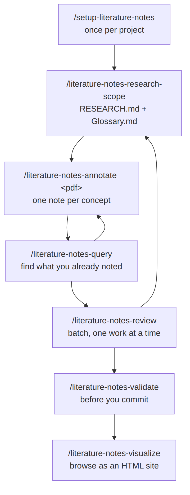
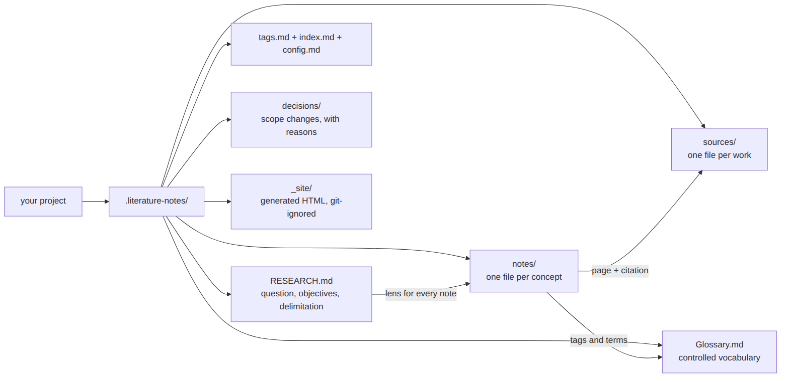
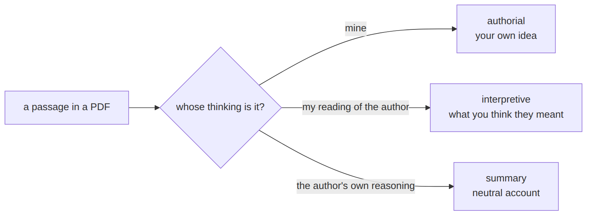
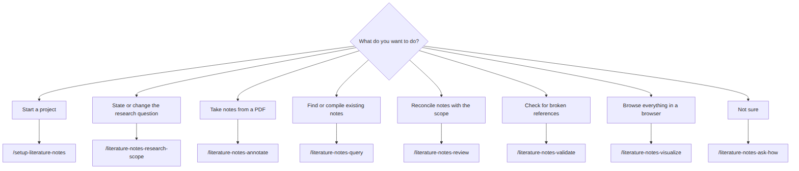

[Home](./) | **How to use it** | [Example](example) | [FAQ](faq)

# How to use it

## Install

The pack ships 8 skills under `skills/`. Copy each folder in `skills/` into
your agent's skills directory (for Claude Code, `~/.claude/skills/` for all
projects or `.claude/skills/` for one project). Then run
`/setup-literature-notes` once in your research project.

Requirements: Python 3. The skills install `pyyaml` and `pypdf` with `pip` the
first time they run. `literature-notes-review` also uses the free third-party
`grilling` skill. The HTML viewer loads its fonts and libraries from public
CDNs when you open it in a browser.

## 1. The workflow

Run `/setup-literature-notes` once. After that you loop through scope, read,
query and review, and validate before you commit.

## 2. What lives on disk

Everything the skills create sits in `.literature-notes/` inside your project.

## 3. The three note kinds

## 4. Which skill do I need?

## Step by step

1. `/setup-literature-notes`: once per project. It asks for three things: how
   cross-references are written (Obsidian wikilinks or plain Markdown links),
   which **citation norm** your research follows, and whether you point at
   **PDF pages** or **printed pages**. For the norm, it looks up the rules,
   shows you a draft file and freezes it only after you approve it.
2. `/literature-notes-research-scope`: state the research question, what is out
   of scope, and the terms worth pinning down.
3. `/literature-notes-annotate <pdf-path>`: read a source or a page range,
   filtered by that scope. This is the step you run most.
4. `/literature-notes-query`: search what you already noted. Run it often.
5. `/literature-notes-review`: now and then, batch the notes nobody has
   reconciled with the scope. It interviews you and updates `RESEARCH.md` and
   `Glossary.md` where your answers push them.
6. `/literature-notes-validate`: before every commit. Add `--check-quotes` to
   confirm each quote appears on the PDF page you cited.

Not sure where you are? Run `/literature-notes-ask-how`.

## Changing the citation norm later

Re-run `/setup-literature-notes` to add or switch a norm. Existing notes keep
the citations they have, and each norm lives in its own file, so a bundle can
carry more than one. A bundle made before this setting, with `abnt_*` fields,
can be migrated: the setup lists what would change and rewrites only when you
confirm.
