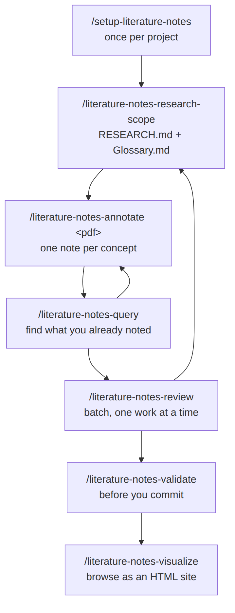

# literature-notes

**English** | [Português (Brasil)](pt-br/)

Eight agent skills that turn academic sources (articles, dissertations,
theses and books) into a structured, queryable wiki of reading notes. Every
note is anchored to a page, cited in the norm your research follows, tagged
against a controlled glossary, and read through your research question.

Available on Agensi. Single-user license.

  <iframe src="https://www.youtube.com/embed/6mFDuLZG1jc" title="literature-notes demo" style="position:absolute;top:0;left:0;width:100%;height:100%;border:0;" allowfullscreen></iframe>

[Watch on YouTube](https://www.youtube.com/watch?v=6mFDuLZG1jc)

## Why I built it

I built these skills to help me study and write my master's dissertation.
Two goals shaped them:

1. **A second brain for academic research.** Every reading becomes small,
   linked, searchable notes, each tied to a page and to the question I am
   asking. I can find what I read, and see how one author connects to another.
2. **Input for writing.** The notes keep the quote, the page and the citation
   in one consistent structure, so an agent, or I, can draft from them and
   every claim traces back to its source. The pack does not write the paper
   for you. It gives you material you can trust and trace.

The aim was a system that is easy to control and to interact with: plain
Markdown files that you own, a handful of commands, and a workflow you can
see.

## What it does

- Takes notes from a PDF, one note per concept, in three kinds:
  **authorial** (your own idea), **interpretive** (your reading of the
  author) and **summary** (a neutral account).
- Cites in **your** norm. Setup asks which one you follow (APA, ABNT, MLA,
  Chicago or another formal norm), looks up the rules, shows you a draft and
  freezes it only after you approve. Every note then carries its citation in
  that norm.
- Points at the right page, by PDF page or by the page printed in the book,
  with an offset when the two differ.
- Keeps a research scope (`RESEARCH.md`) and a controlled glossary
  (`Glossary.md`) that every note answers to, and a review step that updates
  them as your reading changes your mind.
- Queries the notes by tag, source, note kind, page, influence links,
  verification status or free text.
- Validates the bundle for broken references (unknown tags, dangling links,
  undefined glossary terms), and can check that each quote really appears on
  the page you cited.
- Builds a read-only HTML "second brain" with full-text search, backlinks and
  a link graph.
- Writes in your language. A quoted passage stays in the source's language.

## The eight skills

| Skill | Use it to |
| --- | --- |
| `setup-literature-notes` | One-time setup: scaffold `.literature-notes/`, pick the link style, the citation norm and how you count pages. |
| `literature-notes-research-scope` | State the research question and the glossary. |
| `literature-notes-annotate` | Read a PDF and write the notes. |
| `literature-notes-review` | Reconcile pending notes with the scope, one question at a time. |
| `literature-notes-query` | Search what you already noted. |
| `literature-notes-validate` | Check for broken references and, optionally, quotes before a commit. |
| `literature-notes-visualize` | Generate the HTML site. |
| `literature-notes-ask-how` | Ask which skill fits what you are doing. |

## Keep reading

- [How to use it, in diagrams](how-to-use)
- [A worked example, in APA 7](example)
- [FAQ](faq)

## Why a query stays cheap

A query or a validation only brings what matches into the chat, not the whole
bundle. The notes can grow to hundreds of files without each query costing
more.
