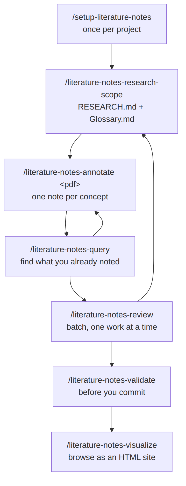
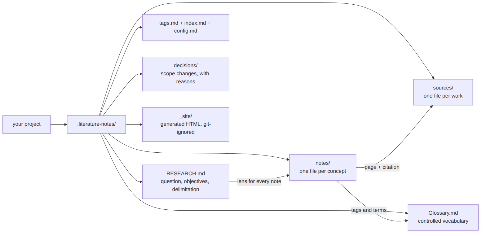

# literature-notes

[English](../) | **Português (Brasil)**

Oito skills de agente que transformam fontes acadêmicas (artigos, dissertações,
teses e livros) em uma wiki estruturada e consultável de notas de leitura.
Cada nota é ancorada a uma página, citada na norma que a sua pesquisa segue,
marcada com um glossário controlado e lida à luz da sua pergunta de pesquisa.

Disponível na Agensi. Licença de um usuário.

  <iframe src="https://www.youtube.com/embed/thB-ZFvSV0k" title="Demonstração do literature-notes" style="position:absolute;top:0;left:0;width:100%;height:100%;border:0;" allowfullscreen></iframe>

[Assistir no YouTube](https://youtu.be/thB-ZFvSV0k)

## O que faz

- Extrai notas de um PDF, uma por conceito, em três tipos: **autoral** (ideia
  sua), **interpretativa** (sua leitura do autor) e **resumo** (relato neutro).
- Cita na **sua** norma. O setup pergunta qual você segue (APA, ABNT, MLA,
  Chicago ou outra norma formal), pesquisa as regras, mostra um rascunho e só
  o congela depois que você aprova.
- Aponta a página certa, pela página do PDF ou pela página impressa, com um
  deslocamento quando elas diferem.
- Mantém um escopo de pesquisa (`RESEARCH.md`) e um glossário controlado
  (`Glossary.md`), e uma etapa de revisão que os atualiza conforme a leitura
  muda o seu entendimento.
- Consulta por tag, fonte, tipo de nota, página, links de influência, status
  de verificação ou texto livre.
- Valida a base (tags desconhecidas, links quebrados, termos sem definição) e
  pode conferir se cada citação literal aparece mesmo na página citada.
- Gera um site HTML somente leitura, com busca, backlinks e grafo de links.
- Escreve no seu idioma. Uma citação literal mantém o idioma da fonte.

## As oito skills

| Skill | Para que serve |
| --- | --- |
| `setup-literature-notes` | Preparação única: cria `.literature-notes/`, escolhe o estilo de links, a norma de citação e como você conta as páginas. |
| `literature-notes-research-scope` | Definir a pergunta de pesquisa e o glossário. |
| `literature-notes-annotate` | Ler um PDF e escrever as notas. |
| `literature-notes-review` | Conciliar notas pendentes com o escopo, uma pergunta de cada vez. |
| `literature-notes-query` | Buscar o que você já anotou. |
| `literature-notes-validate` | Checar referências quebradas e, se quiser, as citações literais, antes do commit. |
| `literature-notes-visualize` | Gerar o site HTML. |
| `literature-notes-ask-how` | Perguntar qual skill serve ao que você faz. |

## Como usar

1. `/setup-literature-notes`: uma vez por projeto. Pergunta o estilo de links, a norma de citação e se você cita a página do PDF ou a impressa.
2. `/literature-notes-research-scope`: pergunta de pesquisa, limites e glossário.
3. `/literature-notes-annotate <caminho-do-pdf>`: ler uma fonte, filtrada pelo escopo.
4. `/literature-notes-query`: buscar o que já está anotado.
5. `/literature-notes-review`: de tempos em tempos, em lote. Entrevista você e atualiza o escopo.
6. `/literature-notes-validate`: antes de cada commit. Com `--check-quotes`, confere as citações literais.

**Instalação:** copie cada pasta de `skills/` para a pasta de skills do seu
agente (no Claude Code, `~/.claude/skills/` ou `.claude/skills/`). Requer
Python 3. A skill `review` usa a skill gratuita `grilling`, de terceiros. O
visualizador HTML carrega fontes e bibliotecas de CDNs públicas.

**Versão anterior com campos `abnt_*`:** rode de novo o `/setup-literature-notes`.
Ele lista o que seria migrado e só altera depois da sua confirmação. Três
skills foram renomeadas: `literature-notes` virou `literature-notes-annotate`,
`literature-notes-scope` virou `literature-notes-research-scope` e
`literature-notes-rescope` virou `literature-notes-review`.

**Licença:** de um usuário. As notas que você cria são suas.
